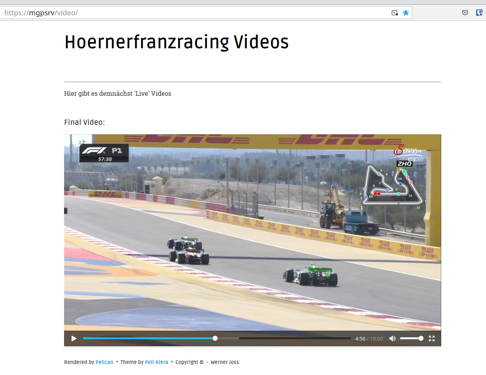

# ServusTv
### A private Repo which holds everything necessary to avoid Geoblocking.
### All you need is a tiny Server located in Austria and this :smile:.

Eine Beschreibung der Problematik zum Thema findet sich [hier](https://hoernerfranzracing.de/werner/kde-linux-web/tips-and-tricks/vpn).  
Die Implementierung des dort genannten Plan A findet sich nun hier und kann auf Anfrage interessierten Personen zur Vefügung gestellt werden.

Das Prinzip ist wie folgt:
- Die zentrale Instanz ist ein in Österreich befindlicher Server (Debian 11 oder 12 Linux VPS).
- Dieser zeichnet zeitgesteuert (at bzw. cron Scheduler) Servus TV Sendungen (Moto GP Rennen) via ffmpeg auf.
- Diese Videos können dann via HLS oder als einfache mp4 Dateien unbeschränkt weiter gestreamt werden, dadurch wird das Servus TV Geoblocking umgangen.
- Zudem entfällt dadurch das Risko einer möglichen VPN-Erkennung, da die Aufnahme ja direkt erfolgt.
- mit einem minimalistischen VPS kommt allerdings nur ein zeitversetztes Streaming einzelner mp4 Videos in Frage, HLS Live-Streaming geht nur mit einem schnellen VPS (> 300 MBit Up/Download Anbindung, > 4 GB RAM...).
- ich denke aber, die Aufzeichnung etwa in 10 Minuten-Chunks (die am Ende automatisch zu einem Video zusammengesetzt werden) ist durchaus akzeptabel, die 'Live-Übertragung' startet dann eben erst 10 Minuten nach Rennstart und nach Ende eines der 10 Minuten-Videos muss man die Seite neu laden und dann das nächste anklicken.

An sich ist das eine einfache, und auch leicht auf eine Teilnehmergruppe zu beschränkende Lösung (Zugriffskontrolle z.B. via htaccess), sie ist allerdings mit dem Risiko behaftet, dass der Server aus irgendwelchen Gründen von Servus TV geblockt wird.

In diesem Fall kann dann der sogenannte Plan B zum Einsatz kommen:
Als Server wird hier nicht mehr ein gemieteter VPS verwendet, sondern ein kleiner Single Board Computer, der bei einem Privatanwender in Österreich steht.  
Damit sollte Geoblocking ausgeschlossen sein, Servus TV wird sich sicher nicht trauen, dynamische IP Adressen (Privatanwender in AT !) zu blockieren.  
Das Problem hierbei ist dann allerdings, wie die am SBC aufgezeichneten Videos von ausserhalb abgerufen werden können, denn
- Privatanwender haben in der Regel ein hohe Download-, aber miserable Upload-Bandbreite (und genau die wird dann gebraucht).
- Der SBC im privaten LAN muss von aussen zugänglich gemacht werden, entweder via Port-Forwardung und DynDns oder mittels eines privaten VPN, in das die Teilnehmer aufgenommen werden.
- Unser Plan B (sofern er denn erforderlich wird) wird zunächst mit einem privaten [Zerotier](https://zerotier.com) VPN realisiert werden.
- Optional kann hier noch ein weiterer VPS dazwischengeschaltet werden, der die Videos vom SBC **EIN Mal** abholt und diese dann der Teilnehmergruppe zur Verfügung stellt.
- das Ganze wird dann aber sicher zu mehr Verzögerung als die oben genannten 10 Minuten führen, wieviel, wird sich zeigen wenn es nötig ist.

### Im Folgenden nun eine technische Dokumentation zu den hier befindlichen Sourcen:  
Im Ordner scripts befinden sich die zur Video-Aufzeichnung notwendigen Shell-Scripte, das wichtigste ist streamrec.sh.  
Diese Scripte sollten in einen in $PATH befindlichen Ordner gespeichert werden.
Der Aufruf von streamrec.sh erfolgt dann via at Scheduler mit einer Steuerdatei z.B. so:  
`at 10:30 tomorrow -f ./sprint.cmd`  
wobei das Command-File sprint.cmd z.B. folgenden Inhalt hat:  
`/home/mgpsrv/bin/streamrec.sh -t 2000 -n 1 -f sprint.mp4 2>&1`
Wichtig ist hier der absolute Pfad zu streamrec.sh, auch wenn der in $PATH enthalten ist !  
Der Ordner video beinhaltet das Web-Interface zum Abruf der Videos durch die Besucher, er ist als Unterordner von /var/www/html (=Webroot) auf dem Webserver gedacht.  
Dorthin müssen auch die Aufzeichnungen von ffmpeg gespeichert werden (siehe streamrec.sh).  
Die Seite selbst wurde mit [Pelican](https://getpelican.com/) erstellt, es ist eine einfache, aber dennoch responsive Seite die wenig Ressourcen beansprucht.  
Die Sourcen (ohne Theme) sind im Ordner pelican.

### System Voraussetzungen:
- (Debian-) Linux Server mit den in system/pkg.lst gelisteten Pakteten, diese können mittels inst.sh (ebendort) automatisch installiert werden.
- Fertig konfigurierter Apache2 Webserver incl. PHP, Webroot ist /var/www/html, das Video Verzeichnis ist /var/www/html/videos, dieses hat UID/GID = www-data
- Der Script-User muss in der Gruppe www-data sein
- ffmpeg als zentrales Video processing Tool

